<div align="center">

# DOOM-BOTS

**Open a folder. Run `doom`. Tell Marcus what you want.**<br>
**Nine AI agents build it.**

[](https://nodejs.org)
[](https://claude.com/claude-code)
[](#)
[](#)
[](#)
[](LICENSE)

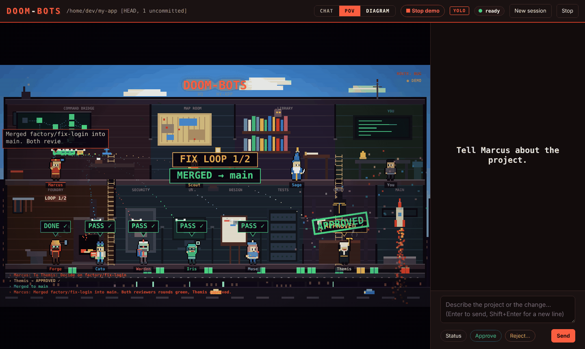

</div>

<br>

## Run it

```bash
git clone https://github.com/sanjeewan24/doom-bots
cd doom-bots && npm link
```

```bash
cd your-project
doom
```

A chat opens in your browser. Tell Marcus what you need.

**Needs:** Node 18+ &nbsp;·&nbsp; [Claude Code](https://claude.com/claude-code) on PATH &nbsp;·&nbsp; `caveman` and `ponytail` skills

<br>

## What you can ask

| | |
|---|---|
| 🆕 **New project** | Marcus plans it, the crew builds it |
| 🐛 **Bug fix** | Scout finds it, Forge fixes it |
| ✨ **Feature** | Scout reads the code, Sage plans the change |
| 🔍 **Unknown codebase** | Scout maps it first |

<br>

## The line

<div align="center">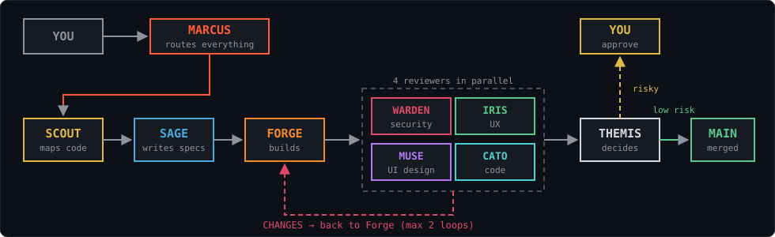</div>

Reviewers send CHANGES back to Forge, **2 loops max**. Risky changes wait for your **Approve**.

<br>

## The crew

| | | |
|:-:|---|---|
| 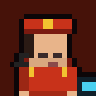 | **Marcus** | Orchestrator. Never writes code |
| 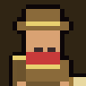 | **Scout** | Maps existing code |
| 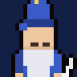 | **Sage** | Writes the specs |
| 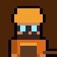 | **Forge** | Builds and fixes |
| 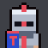 | **Warden** | Security review |
| 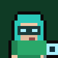 | **Iris** | UX review |
| 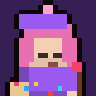 | **Muse** | UI design review |
| 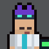 | **Cato** | Code review |
| 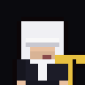 | **Themis** | Final approval |

<br>

## Three views

Switch in the header, or press **Alt+1 / 2 / 3**.

**Chat** &nbsp;·&nbsp; talk to Marcus, watch the crew

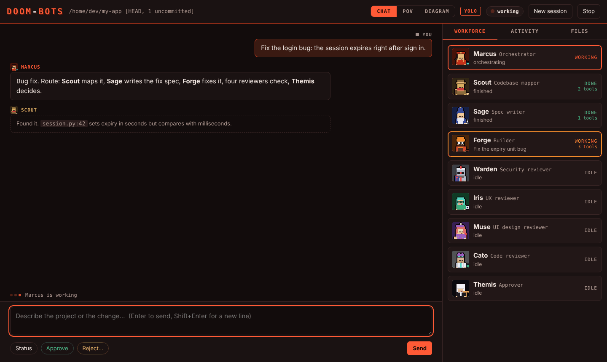

**POV** &nbsp;·&nbsp; the crew at work, live

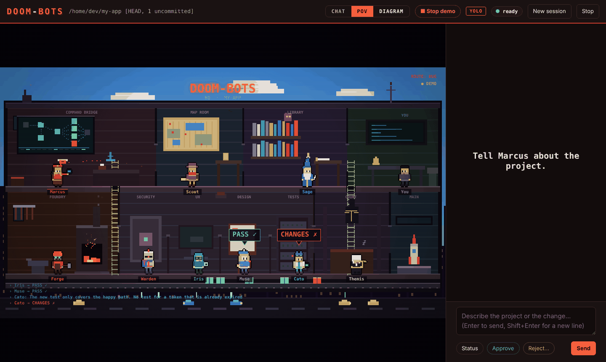

**Diagram** &nbsp;·&nbsp; traffic lights up along the line

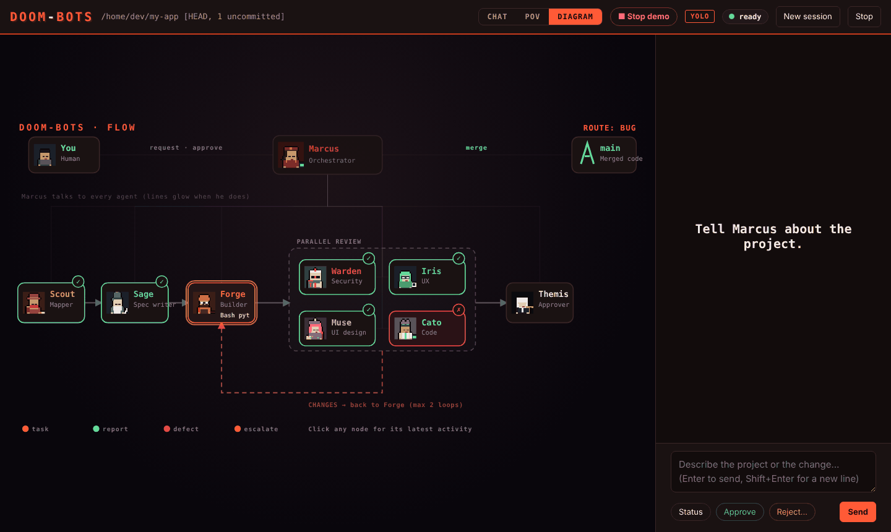

<br>

## Try it free

Hit **Demo** in POV or Diagram. A scripted bug fix plays, no tokens used. **Stop demo** ends it.

<br>

## Commands

| | |
|---|---|
| `doom` | Start in this folder |
| `doom --new` | Fresh session |
| `doom --safe` | Keep Claude Code permission prompts |
| `doom --port 4800` | Pick a port |
| `doom --no-open` | Don't open the browser |
| `doom install` | Reinstall agents and skills |

<br>

## Safety

- Marcus is **locked out of editing files**. A hook blocks it, so he must delegate
- Code changes only on `factory/*` branches
- Runs in **yolo mode** by default. Agents can run any command in your project
- Server is `127.0.0.1` only, behind a random token
- `--safe` brings the prompts back

<br>

## Files

Everything lands in `.doombots/` inside your project. Add it to `.gitignore` if you like.

```
.doombots/
├─ specs/          specs from Sage
├─ reports/        reviews and Themis's decision
├─ events.jsonl    Marcus's log
└─ state.json      where the run stopped
```

<br>

## Test

```bash
npm test
```

<br>

<div align="center">

MIT · See [THIRD-PARTY.md](THIRD-PARTY.md) for bundled security skills

</div>
